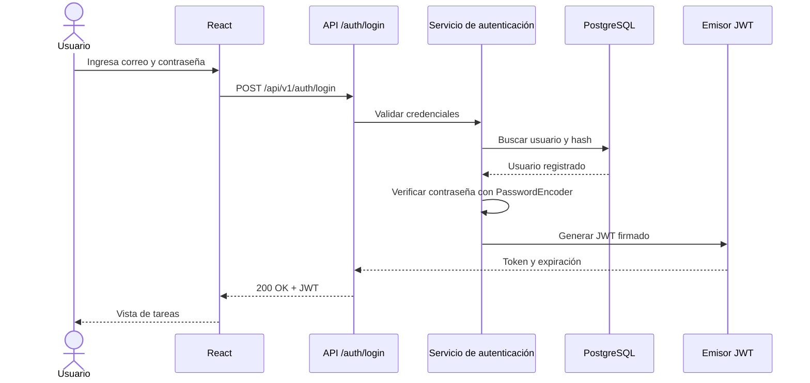

# Laboratorio de extensión · App ToDo: seguridad con Spring Security y JWT

**Escuela Colombiana de Ingeniería Julio Garavito**  
**Asignatura:** Desarrollo y Operaciones de Software (DOSW)  
**Caso de estudio:** App ToDo · Gestión de tareas  
**Base del laboratorio:** [Lab6-G4-AppToDo](https://github.com/DOSW-2026-2/Lab6-G4-AppToDo/blob/main/README.md)  
**Tema central:** autenticación, autorización, JSON Web Tokens (JWT) y protección de APIs REST.

---

## 1. Descripción del reto

La aplicación **ToDo** desarrollada en el laboratorio anterior permite gestionar tareas mediante un frontend en **React**, una API REST en **Spring Boot** y una base de datos **PostgreSQL ejecutada en Docker**. Hasta este punto, las funcionalidades del CRUD no consideran la identidad del usuario que realiza una operación.

**Nueva funcionalidad:** convertir ToDo en una aplicación con **cuentas de usuario y tareas privadas**, de manera que cada persona se autentique y administre únicamente sus propias tareas.

En este laboratorio deberán **extender la aplicación existente**, no crear otra desde cero. Deben preservar la funcionalidad del CRUD y, si el equipo implementó el calendario semanal, hacer que también respete la sesión del usuario.

### Resultado esperado

- Registro de usuarios e inicio de sesión.
- Almacenamiento de contraseñas con un algoritmo de hash adecuado.
- Emisión de un **JWT firmado** después de una autenticación válida.
- Validación del JWT en las peticiones protegidas.
- Autorización por identidad: **cada usuario solo puede gestionar sus propias tareas**.
- Un recurso restringido adicional para demostrar autorización por roles (`USER` y `ADMIN`).
- Frontend React con vistas de registro, inicio de sesión, tareas y cierre de sesión.
- Pruebas automatizadas para los flujos correctos y los intentos de acceso indebido.

> **Alcance:** no se requiere desplegar en la nube ni implementar CI/CD. El sistema debe funcionar **completamente en ambiente local**. No se implementarán OAuth Login con Google, refresh tokens, MFA ni recuperación de contraseña en esta entrega.

---

# 2. Requerimientos funcionales

| Código | Requerimiento | Resultado esperado |
|---|---|---|
| RF-SEG-01 | Registrar usuario | Crear cuenta con nombre, correo y contraseña. |
| RF-SEG-02 | Autenticar usuario | Validar credenciales y emitir JWT firmado. |
| RF-SEG-03 | Mantener sesión en React | Utilizar el token en las peticiones a los recursos protegidos. |
| RF-SEG-04 | Consultar perfil | Obtener los datos no sensibles del usuario autenticado. |
| RF-SEG-05 | Proteger el CRUD | Requerir token válido en los recursos de tareas. |
| RF-SEG-06 | Aislar tareas por usuario | Listar, consultar, crear, editar y eliminar solo tareas propias. |
| RF-SEG-07 | Gestionar autorización por roles | Reservar un endpoint administrativo exclusivamente al rol `ADMIN`. |
| RF-SEG-08 | Cerrar sesión en frontend | Limpiar el estado de autenticación y volver al inicio de sesión. |
| RF-SEG-09 | Manejar errores de seguridad | Diferenciar errores de validación, autenticación, autorización y recursos inexistentes. |
| RF-SEG-10 | Validar seguridad mediante pruebas | Cubrir rutas públicas, protegidas, token inválido y acceso cruzado. |

## 2.1 Reglas funcionales y de seguridad

1. El correo identifica de manera única a cada usuario; se normaliza para evitar duplicados equivalentes.
2. No se permiten cuentas con correo inválido, nombre vacío ni contraseñas inferiores a **8 caracteres**.
3. La contraseña **nunca** debe almacenarse ni devolverse en texto plano. Se debe utilizar un `PasswordEncoder` seguro, por ejemplo BCrypt.
4. El registro público crea exclusivamente usuarios con rol `USER`. Ninguna petición pública podrá elegir `ADMIN`.
5. Las credenciales válidas producen un token firmado con identidad (`sub`), emisor (`iss`), fecha de emisión (`iat`) y expiración (`exp`). Si se incluyen roles, los claims deben verificarse y mapearse a autoridades de Spring Security.
6. Para este laboratorio el JWT tendrá una duración de **30 minutos**. Cuando expire, deberá ser rechazado y el usuario tendrá que iniciar sesión nuevamente.
7. El backend nunca debe confiar en un identificador de usuario recibido desde el formulario o la URL para decidir a quién pertenece una tarea. Debe obtener la identidad de la autenticación validada.
8. La respuesta de creación/consulta de usuario no debe incluir `password`, `passwordHash` ni secretos del servidor.
9. El token debe ser validado **en el backend**; ocultar botones en React no constituye autorización.
10. Las claves de firma JWT no se almacenarán en el repositorio. Se configurarán mediante variables de entorno o un archivo local excluido de Git.
11. No se deben registrar tokens, contraseñas ni cabeceras `Authorization` completas en los logs.
12. Se conservan las operaciones y reglas de negocio del CRUD anterior; la nueva protección se aplica a todas ellas.

---

# 3. Historias de usuario

## HU-SEG-01 · Registro

**Como** visitante de ToDo, **quiero** crear una cuenta con mis datos y una contraseña, **para** comenzar a utilizar la aplicación de manera personal.

**Criterios de aceptación (Gherkin)**

```gherkin
Escenario: Registro exitoso
  Dado que no existe una cuenta con el correo "ana@example.com"
  Cuando registro mi nombre, correo y una contraseña válida
  Entonces se crea una cuenta con rol USER
  Y la contraseña se almacena mediante un hash seguro
  Y la respuesta no contiene la contraseña ni su hash

Escenario: Correo duplicado
  Dado que ya existe una cuenta con el correo "ana@example.com"
  Cuando intento registrarme nuevamente con ese correo
  Entonces la API responde 409 Conflict
  Y no se crea un segundo usuario
```

## HU-SEG-02 · Inicio de sesión

**Como** usuario registrado, **quiero** iniciar sesión con correo y contraseña, **para** obtener acceso a mis tareas.

```gherkin
Escenario: Credenciales válidas
  Dado que tengo una cuenta activa
  Cuando envío mi correo y contraseña correctos
  Entonces la API responde 200 OK
  Y recibo un access token JWT firmado con expiración

Escenario: Credenciales inválidas
  Dado que tengo una cuenta registrada
  Cuando envío una contraseña incorrecta
  Entonces la API responde 401 Unauthorized
  Y no se entrega un access token
```

## HU-SEG-03 · Acceso a las tareas propias

**Como** usuario autenticado, **quiero** ver y modificar únicamente mis tareas, **para** mantener privada mi información.

```gherkin
Escenario: Consultar tareas propias
  Dado que Ana y Luis tienen tareas registradas
  Y he iniciado sesión como Ana
  Cuando consulto GET /api/v1/tasks usando mi JWT
  Entonces recibo únicamente las tareas pertenecientes a Ana

Escenario: Intentar modificar una tarea ajena
  Dado que la tarea 25 pertenece a Luis
  Y he iniciado sesión como Ana
  Cuando intento modificar PUT /api/v1/tasks/25
  Entonces el servidor rechaza la operación
  Y la tarea de Luis permanece sin cambios
```

> Para ocultar la existencia de registros de otros usuarios, en operaciones sobre una tarea por identificador se utilizará **404 Not Found** cuando la tarea no exista o no pertenezca al usuario autenticado. Deben mantener este criterio consistentemente en consulta, edición y eliminación.

## HU-SEG-04 · Protección de recursos

**Como** responsable del sistema, **quiero** que las APIs de tareas exijan un JWT válido, **para** impedir operaciones anónimas o con credenciales falsificadas.

```gherkin
Escenario: Petición sin token
  Cuando consulto GET /api/v1/tasks sin Authorization
  Entonces la API responde 401 Unauthorized

Escenario: Token manipulado o expirado
  Dado que el token fue alterado o expiró
  Cuando consulto GET /api/v1/tasks con ese token
  Entonces la API responde 401 Unauthorized
```

## HU-SEG-05 · Recurso administrativo

**Como** administrador, **quiero** consultar un resumen general no sensible del sistema, **para** conocer su utilización sin exponer las tareas privadas de los usuarios.

```gherkin
Escenario: Acceso administrativo autorizado
  Dado que mi cuenta tiene rol ADMIN
  Cuando consulto GET /api/v1/admin/summary
  Entonces la API responde 200 OK con métricas agregadas

Escenario: Usuario sin privilegios
  Dado que tengo un JWT válido con rol USER
  Cuando consulto GET /api/v1/admin/summary
  Entonces la API responde 403 Forbidden
```

## HU-SEG-06 · Sesión en React

**Como** usuario autenticado, **quiero** acceder a mis tareas mientras dure mi sesión y cerrar sesión cuando termine, **para** controlar el uso de mi cuenta.

```gherkin
Escenario: Cierre de sesión
  Dado que he iniciado sesión
  Cuando presiono "Cerrar sesión"
  Entonces se elimina el token del estado de la aplicación
  Y se ocultan mis tareas
  Y se muestra la pantalla de inicio de sesión
```

> **Nota:** en esta versión el cierre de sesión es **del lado del cliente**. No revoca anticipadamente un JWT ya emitido; el token continuará siendo válido hasta su expiración si alguien lo conserva. Explicar esta limitación en el informe.

---

# 4. Contrato REST requerido

## 4.1 Autenticación y perfil

| Método | Endpoint | Acceso | Resultado principal |
|---|---|---|---|
| `POST` | `/api/v1/auth/register` | Público | `201 Created` |
| `POST` | `/api/v1/auth/login` | Público | `200 OK` y JWT |
| `GET` | `/api/v1/users/me` | Autenticado | `200 OK` con perfil propio |
| `GET` | `/api/v1/admin/summary` | `ADMIN` | `200 OK` |

### Ejemplo · Registro

```http
POST /api/v1/auth/register
Content-Type: application/json
```

```json
{
  "name": "Ana Pérez",
  "email": "ana@example.com",
  "password": "ContrasenaDemo123!"
}
```

Respuesta representativa (sin secretos):

```json
{
  "id": 1,
  "name": "Ana Pérez",
  "email": "ana@example.com",
  "role": "USER"
}
```

### Ejemplo · Inicio de sesión

```http
POST /api/v1/auth/login
Content-Type: application/json
```

```json
{
  "email": "ana@example.com",
  "password": "ContrasenaDemo123!"
}
```

Respuesta conceptual:

```json
{
  "tokenType": "Bearer",
  "accessToken": "<JWT_FIRMADO>",
  "expiresIn": 1800
}
```

**El valor `<JWT_FIRMADO>` es únicamente un marcador ilustrativo. No se debe incluir en el repositorio ningún token real.**

## 4.2 Recursos de tareas existentes

**Mantener las rutas existentes** del laboratorio base e implementar control de acceso:

| Método | Endpoint | Acceso | Comportamiento |
|---|---|---|---|
| `GET` | `/api/v1/tasks` | Autenticado | Devuelve **solo mis tareas**. |
| `GET` | `/api/v1/tasks/{id}` | Autenticado | Devuelve mi tarea; si es ajena o no existe: `404`. |
| `POST` | `/api/v1/tasks` | Autenticado | Crea una tarea asociada a mi usuario. |
| `PUT` | `/api/v1/tasks/{id}` | Autenticado | Modifica exclusivamente mi tarea. |
| `DELETE` | `/api/v1/tasks/{id}` | Autenticado | Elimina exclusivamente mi tarea. |

Si existe un endpoint de calendario o búsqueda por fechas, debe retornar únicamente tareas del usuario autenticado.

### Ejemplo de petición protegida

```http
GET /api/v1/tasks
Authorization: Bearer <JWT_FIRMADO>
```

### Política de errores

| Situación | Código |
|---|---|
| Datos inválidos en registro o actualización | `400 Bad Request` |
| Registro con correo ya existente | `409 Conflict` |
| Login inválido | `401 Unauthorized` |
| Falta de token, token expirado o firma inválida | `401 Unauthorized` |
| JWT válido sin rol requerido para recurso administrativo | `403 Forbidden` |
| Tarea inexistente o perteneciente a otro usuario | `404 Not Found` |

---

# 5. Diseño de la solución que deben realizar

## 5.1 Modelo de datos

El modelo del laboratorio anterior contenía `tasks` con `id`, `title`, `description`, `status`, `priority`, `due_date` y `created_at`. **No eliminen esos campos ni el comportamiento ya implementado.**

Ahora deben incorporar el concepto de **usuario** y la relación de propiedad de las tareas:

- `users`: identificador, nombre, correo único, hash de contraseña, rol y fecha de creación.
- `tasks`: incorporar una clave foránea para identificar al propietario de cada tarea.
- Relación esperada: **un usuario tiene muchas tareas; una tarea pertenece a un usuario**.

**Actividad:** crear el modelo entidad-relación y preparar un script de evolución del esquema, por ejemplo:

```text
database/
├── 001_create_schema.sql       # Versión anterior
└── 002_add_users_security.sql # Nueva migración
```

No se entrega el SQL de la solución. Cada grupo debe definir claves, restricciones, índices y estrategia para datos anteriores. **No se permite borrar las tareas existentes para evitar resolver la migración.** Se deberá documentar cómo se asignan tareas previas a un usuario de prueba o cómo se migra su propietario de manera consistente antes de aplicar la restricción `NOT NULL`.

> Mantengan el uso de PostgreSQL mediante la **imagen Docker del laboratorio original**. No es necesario instalar PostgreSQL localmente ni migrar a Docker Compose.

## 5.2 Diseño de clases

Diseñar o actualizar el diagrama de clases considerando, al menos, las responsabilidades de:

- usuario / entidad de persistencia;
- tarea / entidad de persistencia;
- repositorios;
- servicios de registro y autenticación;
- emisión y validación de JWT;
- configuración y reglas de Spring Security;
- controladores REST;
- DTOs de registro, login, respuesta de perfil y acceso a tareas;
- manejo centralizado de excepciones.

No es obligatorio usar exactamente estos nombres de clases. Sí deben justificar **dónde está cada responsabilidad** y cómo se conecta con la arquitectura existente.

## 5.3 Actualización C4

Actualizar en el README:

1. **Nivel 1 · Contexto:** usuario y sistema ToDo.
2. **Nivel 2 · Contenedores:** React, API Spring Boot y PostgreSQL, con la comunicación autenticada.
3. **Nivel 3 · Componentes:** controlador de autenticación, componentes de seguridad, servicios, repositorios y controladores de tareas.

Las imágenes o diagramas deben corresponder a la implementación final, no a una arquitectura ideal distinta del código entregado.

---

# 6. Desarrollo del laboratorio · Paso a paso

## Parte 1 · Punto de partida y planeación

1. Clonar o continuar el repositorio del laboratorio ToDo anterior.
2. Comprobar que **Docker + PostgreSQL + Spring Boot + React** funcionen antes de modificar código.
3. Crear una rama para la funcionalidad de seguridad (por ejemplo, `feature/jwt-security`).
4. Definir y organizar en Jira una **épica de seguridad**, sus features, historias de usuario y tareas de implementación/pruebas.
5. Guardar en el README una breve descripción del estado inicial y el alcance de los cambios.
6. Actualizar los diagramas previstos, identificando primero los componentes que se modificarán.

**Evidencia:** captura del estado inicial del CRUD y enlace al tablero de Jira.

## Parte 2 · Base de datos y persistencia

1. Diseñar `users` y su relación con `tasks`.
2. Crear el script SQL de migración **sin perder la información anterior**.
3. Ejecutar la migración en PostgreSQL dentro del contenedor Docker que ya utiliza el proyecto.
4. Crear o adaptar entidades, enums y repositorios JPA.
5. Asegurar la unicidad del correo y la obligatoriedad del propietario de la tarea.
6. Incorporar pruebas de repositorio que validen el acceso por propietario y la consulta de tareas ajenas.

**Verificación sugerida:** demostrar que Ana y Luis tienen tareas distintas en PostgreSQL.

## Parte 3 · Spring Security y credenciales

1. Incorporar la dependencia **Spring Security** y el soporte de JWT que hayan seleccionado.
2. Diseñar y documentar el mecanismo de hash de contraseñas, utilizando `PasswordEncoder`.
3. Implementar registro con validación de campos y correo único.
4. Implementar autenticación por correo y contraseña.
5. Configurar una cadena `SecurityFilterChain` de acuerdo con las versiones de Spring Boot / Spring Security presentes en el proyecto.
6. Permitir únicamente los endpoints públicos de registro y login; proteger los demás.
7. Configurar sesiones **stateless** para el esquema de API con JWT en header `Authorization`.

**No se permite** utilizar contraseñas en texto plano, `NoOpPasswordEncoder`, desactivar la seguridad para `/**` ni aceptar el rol `ADMIN` desde el registro público.

## Parte 4 · Generación y validación de JWT

Diseñar e implementar el flujo completo:



**Aspectos obligatorios:**

- Firmar criptográficamente el JWT y verificar su firma en cada solicitud protegida.
- Validar `exp`, `iss` e identidad del sujeto; verificar coherencia del rol o autoridad cuando aplique.
- Configurar la llave de firma fuera del código fuente.
- Reconocer `Authorization: Bearer <token>`.
- Probar modificación de un carácter del token y expiración.
- **No basta con decodificar Base64**: un JWT decodificado no es necesariamente válido.

**Pista técnica (no solución):** Spring Security permite proteger APIs con soporte OAuth2 Resource Server incluso cuando el token JWT es emitido por el propio backend. Pueden explorar `JwtDecoder`, `JwtEncoder` / `NimbusJwtEncoder`, `SecurityFilterChain` y el conversor de claims a autoridades. Deben garantizar que generación y validación utilicen la misma configuración criptográfica.

## Parte 5 · Autorización y protección del CRUD

1. Proteger el CRUD completo de tareas.
2. Asociar cada nueva tarea al usuario **extraído del contexto de seguridad**, no al ID enviado por el cliente.
3. Limitar las consultas de `TaskRepository` y `TaskService` al usuario autenticado.
4. Evitar que una petición `GET`, `PUT` o `DELETE` sobre una tarea ajena pueda consultar o modificar la información.
5. Proteger `/api/v1/admin/summary` mediante un rol administrativo (por URL o por método, según su diseño).
6. Documentar cómo se crea una cuenta `ADMIN` **solo para desarrollo local**, sin permitir elevación pública de privilegios. No publicar contraseñas reales.
7. Verificar la diferencia entre **401**, **403** y **404** con pruebas.

**Advertencia:** no es suficiente filtrar la lista de tareas en React. Un atacante podría llamar directamente al endpoint utilizando el ID de otra tarea. La restricción debe existir en los servicios / repositorios del backend.

## Parte 6 · Frontend React

Incorporar componentes o páginas (los nombres son sugeridos):

```text
frontend/src/
├── api/
│   ├── authApi.js
│   └── taskApi.js
├── features/
│   ├── auth/
│   │   ├── components/LoginForm.jsx
│   │   ├── components/RegisterForm.jsx
│   │   └── context/AuthContext.jsx
│   └── tasks/
│       └── ... componentes ya existentes ...
└── App.jsx
```

**Comportamiento requerido:**

- Mostrar registro e inicio de sesión cuando no hay una sesión válida.
- Consumir `/auth/login` y conservar el token **en memoria** (Context, estado o solución equivalente).
- Incorporar `Authorization: Bearer ...` en peticiones protegidas desde `taskApi.js`.
- Mostrar un estado de carga y mensajes adecuados cuando un recurso falle.
- Si el backend responde `401` por token expirado, limpiar la sesión y redirigir al login.
- Agregar botón **Cerrar sesión** que elimine el estado de autenticación.
- Evitar mostrar las tareas del usuario anterior después del cierre de sesión.
- Si existe calendario semanal, mantenerlo protegido y filtrado por propietario.

**Decisión para este laboratorio:** conservar el token en memoria y solicitar nuevo login después de recargar la página. Esto evita persistir JWT en `localStorage`; la aplicación deberá documentar la consecuencia de perder la sesión al recargar. No se exige implementar cookies ni refresh tokens.

### Mockup de referencia · Inicio de sesión

```text
┌─────────────────────────────────────────────┐
│                    TO DO                    │
│                INICIAR SESIÓN               │
│                                             │
│ Correo                                      │
│ [_______________________________________]   │
│ Contraseña                                  │
│ [_______________________________________]   │
│                                             │
│           [  Iniciar sesión  ]              │
│                                             │
│        ¿No tienes cuenta? Regístrate       │
└─────────────────────────────────────────────┘
```

### Mockup de referencia · Tareas autenticadas

```text
┌────────────────────────────────────────────────────────┐
│ TO DO                       Ana Pérez  [Cerrar sesión] │
├────────────────────────────────────────────────────────┤
│ MIS TAREAS                      [ + Nueva tarea ]       │
│                                                        │
│  [HIGH] Entregar laboratorio       PENDING              │
│         Fecha límite: 25/10        [Editar] [Eliminar]  │
│                                                        │
│  [LOW] Organizar apuntes          COMPLETED             │
│         Fecha límite: 27/10        [Editar] [Eliminar]  │
└────────────────────────────────────────────────────────┘
```

*Estos prototipos indican componentes mínimos; el diseño gráfico es libre.*

## Parte 7 · Pruebas automatizadas

Todas las funcionalidades nuevas deberán tener **pruebas unitarias**, y los controles de acceso requerirán también **pruebas de integración**. Conservar y adaptar las pruebas del CRUD anterior.

### Matriz mínima de pruebas

| ID | Prueba | Resultado esperado |
|---|---|---|
| PT-01 | Registrar usuario válido | `201`, usuario con rol `USER`. |
| PT-02 | Intentar registrar un correo duplicado | `409`, sin duplicados. |
| PT-03 | Guardar contraseña | Hash; no texto plano. |
| PT-04 | Login correcto | `200` con token firmado. |
| PT-05 | Login incorrecto | `401` sin token. |
| PT-06 | Consultar tareas sin token | `401`. |
| PT-07 | Consultar tareas con token válido | `200` y solo las propias. |
| PT-08 | Token modificado | `401`. |
| PT-09 | Token expirado | `401`. |
| PT-10 | Consultar tarea ajena | `404`, sin filtración de datos. |
| PT-11 | Modificar tarea ajena | `404`, sin cambios en BD. |
| PT-12 | Eliminar tarea ajena | `404`, sin cambios en BD. |
| PT-13 | Crear tarea autenticada | Se asigna el propietario correcto. |
| PT-14 | Usuario `USER` accede a `/admin/summary` | `403`. |
| PT-15 | Usuario `ADMIN` accede a `/admin/summary` | `200`. |
| PT-16 | Cerrar sesión desde React | Token y tareas del usuario anterior dejan de estar disponibles en UI. |
| PT-17 | Respuesta `401` desde una petición React | Redirige a inicio de sesión. |
| PT-18 | Usuario distinto inicia sesión | Solo se muestran sus propias tareas. |

**Pruebas esperadas:**

- Backend: JUnit 5, Mockito y herramientas de prueba de Spring (MockMvc o equivalente).
- Integración: pruebas de seguridad HTTP reales a nivel de aplicación y de persistencia que verifiquen propiedad de datos. Pueden usar PostgreSQL de pruebas (por ejemplo, un contenedor aislado) cuando corresponda.
- Frontend: Vitest y React Testing Library (o las herramientas ya instaladas).
- Cobertura: generar un reporte con JaCoCo y documentar el porcentaje obtenido; **la cobertura no reemplaza la validación de escenarios de seguridad**.

### Comandos de referencia

```bash
# Desde backend/
mvn clean verify

# Desde frontend/
npm test -- --run
```

*Ajustar el comando de pruebas frontend a los scripts reales del `package.json`.*

## Parte 8 · Verificación manual de punta a punta

Deben realizar un recorrido completo:

1. Encender PostgreSQL desde Docker (el contenedor anterior).
2. Iniciar Spring Boot.
3. Iniciar React.
4. Registrar a **Ana** e iniciar sesión.
5. Crear dos tareas para Ana.
6. Cerrar sesión e iniciar sesión como **Luis**.
7. Verificar que Luis no vea las tareas de Ana.
8. Intentar desde un cliente HTTP modificar una tarea de Ana usando el JWT de Luis: el servidor debe rechazarla.
9. Intentar consumir una ruta protegida sin token y con uno alterado.
10. Probar el recurso `/admin/summary` con `USER` y con `ADMIN`.
11. Verificar en PostgreSQL que las tareas están relacionadas con propietarios distintos.
12. Mostrar los resultados de pruebas automatizadas.

---

# 7. Documentación requerida en GitHub

Actualizar el **README principal** del repositorio incluyendo:

1. Alcance de la nueva funcionalidad.
2. Requerimientos implementados e historias de usuario con criterios de aceptación.
3. Capturas y enlace al tablero de Jira (épica, feature, historias y tareas).
4. **Diagramas C4 actualizados**: contexto, contenedores y componentes.
5. **Diagrama de clases actualizado** y modelo entidad-relación.
6. Flujo de autenticación JWT (puede hacerse con Mermaid).
7. Contrato de endpoints: públicos, autenticados y de administrador.
8. Descripción de las decisiones de seguridad adoptadas: firma JWT, duración, almacenamiento frontend, contraseña, roles, CORS y tratamiento de errores.
9. Pasos claros para ejecutar localmente la aplicación y configurar **variables de entorno**, sin incluir sus valores secretos.
10. Evidencia del funcionamiento del CRUD protegido, pruebas y aislamiento por usuario.
11. Resultados de las pruebas y cobertura.
12. **Enlace al video de demostración**.

Estructura sugerida:

```text
todo-fullstack/
├── backend/
├── frontend/
├── database/
│   ├── 001_create_schema.sql
│   └── 002_add_users_security.sql
├── docs/
│   ├── diagrams/
│   ├── evidence/
│   └── informe-seguridad-jwt.md
├── .gitignore
├── .env.example             # Variables sin valores sensibles
└── README.md                # Documentación actualizada
```

> El proyecto ya existente puede organizarse de otra manera. No se evaluará que copie exactamente este árbol, sino que mantenga una separación clara de responsabilidades y documentación reproducible.

---

# 8. Video obligatorio de funcionamiento local

**Duración sugerida: 6 a 10 minutos.** Adjuntar el enlace en el README. Debe ser accesible para el docente.

El video debe incluir:

1. La aplicación corriendo **localmente**: PostgreSQL en Docker, API Spring Boot y frontend React.
2. Registro de dos usuarios e inicio de sesión.
3. Obtención de un JWT (sin exhibir su valor completo) y explicación de cómo se envía a la API.
4. CRUD de tareas desde React con el usuario A.
5. Inicio de sesión del usuario B y verificación de que no aparecen las tareas del usuario A.
6. Peticiones sin token, con token inválido y acceso a tareas ajenas.
7. Acceso al endpoint administrativo con un usuario `USER` y otro `ADMIN`.
8. Ejecución de pruebas automáticas y demostración del estado de la base de datos.
9. Recorrido breve por los diagramas y la organización del código.

**No se acepta** un video que solo muestre Postman, las pantallas sin integración o código sin ejecutar.

---

# 9. Informe final · Preguntas de comprensión

Responder en `docs/informe-seguridad-jwt.md` con explicaciones basadas en la implementación del equipo:

1. ¿Cuál es la diferencia entre **autenticación** y **autorización**? Dé un ejemplo real de ToDo.
2. Explique cómo se genera un JWT, qué contienen sus partes y cómo verifica Spring Boot que no fue manipulado.
3. ¿Por qué **decodificar el payload** de un JWT no equivale a validar su autenticidad?
4. ¿Qué sucede exactamente cuando un token **vence** y el usuario intenta consultar sus tareas?
5. ¿Por qué no se deben almacenar las contraseñas en texto plano? ¿Cómo verifican la contraseña durante el login?
6. ¿Qué diferencia existe entre responder **401 Unauthorized** y **403 Forbidden**? Dé ejemplos de los endpoints implementados.
7. ¿Cómo impidieron que un usuario editara una tarea de otro, incluso con un JWT válido?
8. ¿Por qué **ocultar botones** en React no es suficiente para proteger los datos?
9. ¿Qué ventajas y limitaciones tuvo conservar el JWT **en memoria** en el frontend?
10. ¿Qué limitación tiene el cierre de sesión sin revocación de tokens? ¿Qué solución propondría para un sistema real?
11. ¿Cuáles son las consecuencias de almacenar una llave de firma JWT dentro de GitHub?
12. ¿Qué pruebas del equipo demuestran la seguridad del CRUD y no solamente su funcionamiento correcto?

---

# 10. Criterios de evaluación sugeridos

| Componente | Porcentaje |
|---|---:|
| Requerimientos, Jira y diseño actualizado | 15 % |
| Modelo de datos y persistencia por propietario | 15 % |
| Registro, login y almacenamiento seguro de contraseñas | 15 % |
| Generación y validación de JWT | 15 % |
| Protección de recursos, propiedad de tareas y rol ADMIN | 15 % |
| Integración con React | 10 % |
| Pruebas automatizadas | 10 % |
| README, informe y video de funcionamiento | 5 % |
| **Total** | **100 %** |

## Definition of Done

- [ ] El CRUD original continúa funcionando para usuarios autenticados.
- [ ] Es posible registrarse e iniciar sesión.
- [ ] Las contraseñas se almacenan de forma segura.
- [ ] El JWT está firmado, vence y se valida en el servidor.
- [ ] Los endpoints de tareas rechazan peticiones sin autenticación.
- [ ] Ningún usuario puede ver, modificar o eliminar tareas ajenas.
- [ ] El rol `USER` no puede acceder al recurso exclusivo `ADMIN`.
- [ ] React consume recursos protegidos y permite cerrar sesión.
- [ ] Los tests nuevos y los del laboratorio anterior finalizan correctamente.
- [ ] Los diagramas C4, de clases y de datos se encuentran actualizados.
- [ ] Los secretos están fuera del repositorio.
- [ ] Se publicaron el informe y el video de funcionamiento local.

---

# 11. Referencias técnicas

- [Laboratorio base ToDo · DOSW-2026-2](https://github.com/DOSW-2026-2/Lab6-G4-AppToDo/blob/main/README.md)
- [Spring Security · documentación oficial](https://docs.spring.io/spring-security/reference/)
- [Spring Security · protección de APIs con JWT](https://docs.spring.io/spring-security/reference/servlet/oauth2/resource-server/jwt.html)
- [Spring Security · almacenamiento de contraseñas](https://docs.spring.io/spring-security/reference/features/authentication/password-storage.html)
- [Spring Data JPA](https://spring.io/projects/spring-data-jpa)
- [React · documentación oficial](https://react.dev/)
- [OWASP · API Security](https://owasp.org/www-project-api-security/)

---

## Cierre

El propósito del laboratorio es demostrar que una aplicación deja de ser simplemente un CRUD cuando debe **identificar quién realiza cada operación, verificar que está autorizado y proteger la información de los demás usuarios**. El equipo deberá poder explicar el recorrido completo de una petición autenticada desde React, pasando por Spring Security, el controlador y la capa de servicios, hasta PostgreSQL.
